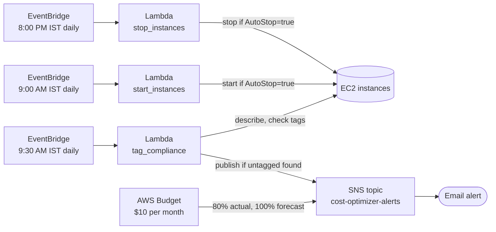
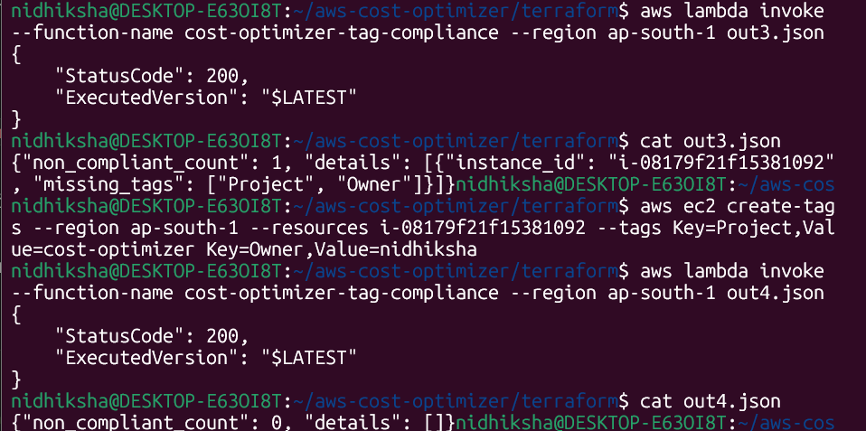
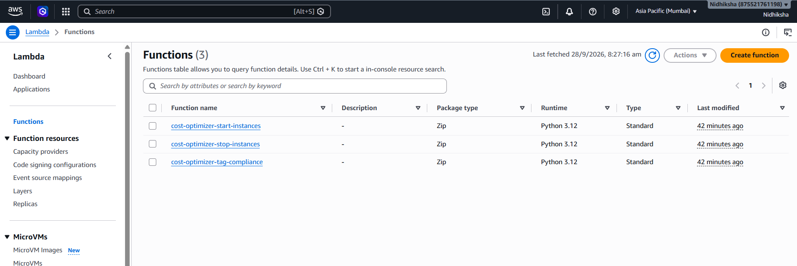
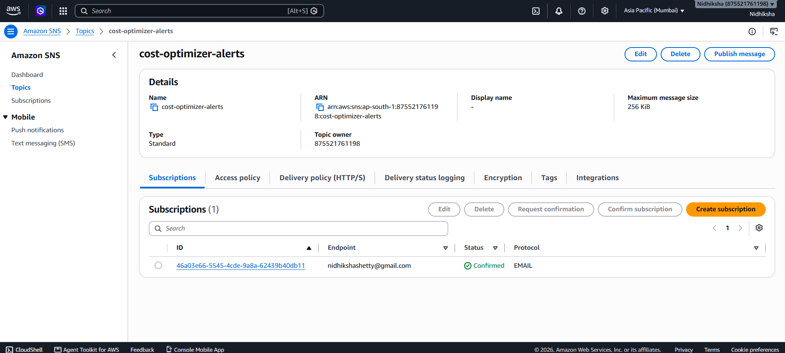
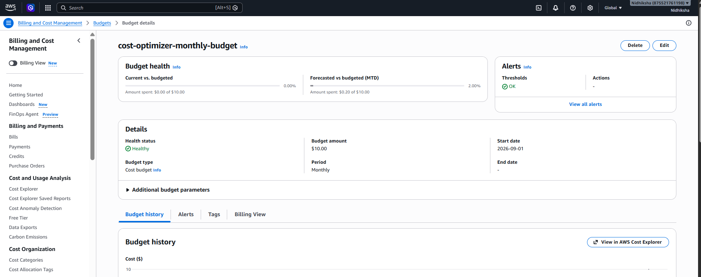

# AWS Cost Optimization Automation

Serverless automation that cuts idle EC2 spend and keeps AWS resources accountable:
scheduled shutdown of non-production instances, a monthly budget with alerts, and a
daily tagging-compliance check. Built with Python Lambda functions, EventBridge, SNS,
AWS Budgets, and Terraform.

Companion to my [Self-Healing GitOps Platform on EKS](https://github.com/nidhiksha-ananth/self-healing-gitops-eks-platform).

---

## Architecture



## What it does

| Component | Trigger | Behavior |
|---|---|---|
| `stop_instances` Lambda | EventBridge cron, 8:00 PM IST | Stops running EC2 instances tagged `AutoStop=true` |
| `start_instances` Lambda | EventBridge cron, 9:00 AM IST | Starts stopped EC2 instances tagged `AutoStop=true` |
| `tag_compliance` Lambda | EventBridge cron, 9:30 AM IST | Finds EC2 instances missing `Project` or `Owner` tags and emails a report via SNS |
| AWS Budget | Continuous | Alerts at 80% of actual spend and 100% of forecasted spend against a monthly limit |

## Design decisions

- **Opt-in by tag, never opt-out.** The stop/start functions only touch instances explicitly
  tagged `AutoStop=true`. Untagged and production instances are never affected, so a
  mistake in scheduling can't take down something critical.
- **Least-privilege IAM.** Each function gets its own role with only the actions it needs:
  the scheduler can describe/stop/start EC2 and write logs; the compliance checker can
  describe EC2 and publish to one specific SNS topic.
- **One alert channel.** Budget alerts and compliance findings share a single SNS topic, so
  there is one place to subscribe and one place to manage notifications.
- **Everything in Terraform.** All resources, including the budget, are declared as code and
  can be created or destroyed in one command.

## Verified results

Each behavior below was tested end to end against real AWS resources.

**Scheduler:** launched a tagged test instance, invoked the stop function, confirmed the
instance went `running` → `stopped`, then invoked the start function and confirmed it came
back. Both functions returned the affected instance ID in their response.

**Tagging compliance, before and after:** the check flagged an instance missing its
`Project` and `Owner` tags and emailed an alert. After adding the tags, re-running the check
returned zero non-compliant instances.



**Deployed functions:**



**Alert channel with confirmed email subscription:**



**Budget, healthy, with alert thresholds configured:**



## Estimated savings (illustrative)

The schedule keeps tagged instances off for 13 hours a day (8 PM to 9 AM IST), which is
about 54% of daily running hours.

As a worked example using approximate on-demand pricing: a `t3.small` at roughly $0.02 per
hour costs about $15 per month running around the clock. Stopping it for 13 hours a day
saves roughly $8 per month per instance. Check current pricing for your region before
relying on these numbers.

Two caveats:
- Savings apply to **compute only**. Stopped instances still incur EBS storage charges.
- This was tested on a single instance. The figures above are an estimate from the schedule
  and published pricing, not measured production savings.

## Tech stack

| Layer | Tools |
|---|---|
| Compute | AWS Lambda (Python 3.12, boto3) |
| Scheduling | Amazon EventBridge |
| Alerting | Amazon SNS, AWS Budgets |
| Infrastructure as Code | Terraform |
| Access control | IAM roles scoped per function |

## Repository structure

```
.
├── lambda/
│   ├── stop_instances.py
│   ├── start_instances.py
│   └── tag_compliance.py
├── terraform/
│   ├── providers.tf
│   ├── variables.tf
│   ├── variables_day2.tf
│   ├── iam.tf
│   ├── lambda.tf
│   ├── eventbridge.tf
│   ├── sns.tf
│   ├── budget.tf
│   ├── tag_compliance.tf
│   └── outputs.tf
└── docs/screenshots/
```

## Run it yourself

```bash
cd terraform
terraform init
terraform apply -var="alert_email=you@example.com"
```

After applying, open the confirmation email from AWS Notifications and click
**Confirm subscription**. Without that step, no alerts will be delivered.

Test the scheduler without waiting for the cron:

```bash
aws ec2 create-tags --resources <instance-id> --tags Key=AutoStop,Value=true
aws lambda invoke --function-name cost-optimizer-stop-instances out.json
aws lambda invoke --function-name cost-optimizer-start-instances out.json
```

Test the compliance check:

```bash
aws lambda invoke --function-name cost-optimizer-tag-compliance out.json
cat out.json
```

Tear everything down when finished:

```bash
terraform destroy -var="alert_email=you@example.com"
```

## Limitations and next steps

- Covers EC2 only. RDS instances and other services are not scheduled.
- The schedule runs every day including weekends, and does not account for holidays.
- No dry-run mode. A safer version would log what it *would* stop before enabling real stops.
- The compliance check flags missing tags but does not remediate them.
- Orphaned resources (unattached EBS volumes, old snapshots) are not detected. This is the
  natural next feature, since they are a common source of silent waste.
- The budget alert depends on real billing data, so it cannot be triggered on demand for testing.

## Author

Built by Nidhiksha, transitioning into Cloud/DevOps from a Helpdesk Support background.
[GitHub](https://github.com/nidhiksha-ananth)
